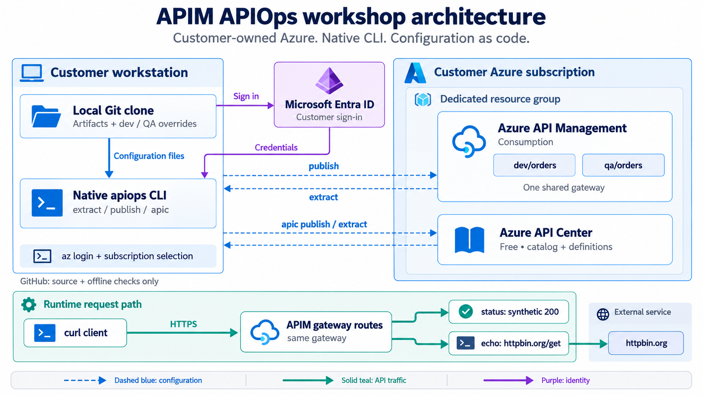
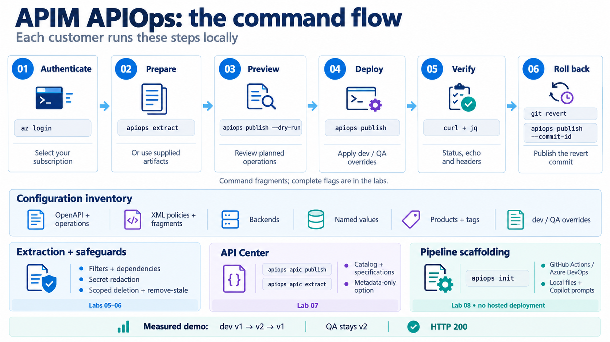

# APIM APIOps workshop

A customer workshop using the **real `apiops` command line**. Customers sign in to their own Azure tenant and subscription, then execute each command themselves. There is no Python deployment wrapper and no Azure deployment connection configured in this repository.

Deploy an Orders API to Azure API Management, promote its configuration to QA, change a release and roll it back. Explore extraction, filtering, dependencies, secret redaction, scoped deletion, API Center and pipeline generation.

[Download the Microsoft-themed workshop PowerPoint](docs/presentation/APIM-APIOps-Customer-Workshop.pptx).

[Start the workshop](#start-here) · [Architecture](#architecture) · [Lab index](#workshop-path)

## Architecture

The workshop runs from **your workstation into your Azure subscription**. Git stores the configuration; the native `apiops` CLI reads or changes Azure resources using your authenticated identity.

[](docs/images/apim-apiops-architecture.png)

| Boundary | What runs here | Why it matters |
|---|---|---|
| Your workstation | Azure CLI login, native `apiops`, Git, curl and jq | You select the tenant, subscription and resource names in your local `.env`. |
| Your Azure resource group | APIM Consumption and API Center Free | Azure CLI provisions resources; APIOps manages their configuration. |
| APIM gateway | `/dev/orders` and `/qa/orders` | Shared artifacts plus overrides create two namespaces on **one gateway**, not two isolated environments. |
| API Center | API metadata, versions, definitions and specifications | A separate catalog exercise. These labs do not configure automatic synchronization from APIM. |
| Public GitHub repository | Workshop files, content checks and code analysis | It has no Azure deployment identity or configured deployment workflow. |

**Two kinds of traffic:** dashed blue arrows show configuration reads/writes. Solid teal arrows show live API requests. `GET /{dev|qa}/orders/status` returns synthetic JSON directly from an operation policy. `GET /{dev|qa}/orders/echo` rewrites to `/get` on the public `httpbin.org` backend. Status sets its response headers directly; echo uses the shared outbound header fragment.

The diagram repeats the gateway in the runtime row to show its request path; it is the same APIM service. Authentication uses the CLI's `DefaultAzureCredential` support. The supplied `.env.example` sets `AZURE_TOKEN_CREDENTIALS=AzureCliCredential` to use the Azure CLI account you selected.

## Command flow and deep dive

[](docs/images/apim-apiops-command-flow.png)

The image shows **command fragments**. Use the linked labs for complete commands, target flags and assertions.

| Flow | Native command or option | What the lab proves |
|---|---|---|
| Prepare and deploy | `apiops publish --dry-run`, then `apiops publish --overrides …` | [Lab 02](docs/labs/02-deploy.md): shared files deploy dev and QA. |
| Change and recover | `--commit-id`, `git revert`, publish the revert commit | [Lab 03](docs/labs/03-release.md): dev v1 → v2 → v1; QA stays v2. Wait for gateway propagation before asserting results. |
| Environment configuration | `--overrides` | [Lab 04](docs/labs/04-overrides.md): prefixes and values change per target. An override-only commit needs a full publish. |
| Read selected resources | `apiops extract --filter …`, `--no-transitive` | [Lab 05](docs/labs/05-filtering.md): dependency expansion, exact selection, wildcards and exclusions. |
| Handle secrets and removal | Redaction checks, `--delete-unmatched`, `--remove-stale` | [Lab 06](docs/labs/06-guards.md): blocked redacted publish, one commit-scoped remote deletion, then stale local-file removal. |
| Back up the catalog | `apiops apic extract`, `apiops apic publish`, `--no-specifications` | [Lab 07](docs/labs/07-api-center.md): catalog replay with or without specification files. |
| Generate automation examples | `apiops init --ci …`, `--force` | [Lab 08](docs/labs/08-cicd.md): local GitHub Actions/Azure DevOps files and Copilot prompts. Connecting a pipeline to Azure is a separate customer decision. |
| Inspect and verify | `--format json`, `--log-level`, `curl`, `jq` | [Labs 09–10](docs/labs/09-cli-utilities.md): inspect plans, exit codes and live responses. |

**Measured scope:** the customer path passed against newly created APIM Consumption and API Center Free resources. The standard public npm installation also passed on GitHub-hosted Linux with Node.js 22 and 24, independently of the author's corporate network. [Customer-readiness evidence](validation/README.md) records the exact scope. A dry run is a plan, not proof of Azure acceptance or runtime correctness.

[Download the self-contained architecture guide](docs/APIM-APIOps-Architecture.html) and open it in a browser for component rationale, trust boundaries and customer decisions. The images above open at full resolution when selected.

References: [APIOps CLI](https://github.com/Azure/apiops-cli), [Microsoft Learn workflow](https://learn.microsoft.com/en-us/azure/api-management/how-to-manage-apiops-cli), [API Center overview](https://learn.microsoft.com/en-us/azure/api-center/overview).


## Start here

Requirements: **Node.js 22+, npm, Azure CLI, Git, jq and curl**. Commands require **Bash** on macOS/Linux or WSL, not PowerShell or zsh. Keep one Bash session open and run Labs 00–11 in order. Configure a Git name/email for the commit exercises. You do not need Python to follow the labs. If global npm installation is denied, use the [local-prefix fallback](docs/labs/00-setup.md) and continue with the same native `apiops` commands. In WSL, install and run all tools inside WSL.

```bash
set -euo pipefail
git clone https://github.com/msftse-org/apim-apiops-workshop.git
cd apim-apiops-workshop
export WORKSHOP_ROOT="$PWD"
npm install -g @azure-tools/apiops-cli@1.0.5
apiops --version
cp .env.example .env
# Edit .env with YOUR tenant, subscription, names and publisher email.
source .env
unset COMMIT_ID
mkdir -p .work
az login --tenant "$TENANT_ID"
az account set --subscription "$AZURE_SUBSCRIPTION_ID"
az account show --query '{tenant:tenantId,subscription:id,name:name}' -o table
```

The normal customer registry is `https://registry.npmjs.org/`. If your organization uses a VPN or approved npm mirror, retain that local configuration; [Lab 00](docs/labs/00-setup.md) explains both paths. No corporate registry is required by this repository.

Start [Lab 00](docs/labs/00-setup.md) after the setup block. With `set -euo pipefail`, an unexpected command failure stops the session; fix the error before continuing. Labs 03/04 and 06/10 share temporary directory variables. If the terminal closes, follow the recovery instructions in Lab 00.

Use a dedicated sandbox resource group. Ask your Azure administrator for the privileges needed to create resources and manage their API configuration. If you already have a dedicated APIM and API Center, enter their names and skip resource creation. The labs never require access to the author's Azure environment.

## Workshop path

| Lab | What the customer runs | What to observe |
|---|---|---|
| [00. CLI and Azure login](docs/labs/00-setup.md) | `npm`, `apiops --help`, `az login` | Correct CLI, tenant and subscription |
| [01. Azure resources](docs/labs/01-resources.md) | `az group`, `az apim`, `az rest` | APIM Consumption and API Center Free |
| [02. Deploy dev and QA](docs/labs/02-deploy.md) | `apiops publish`, `--dry-run`, `curl` | Two routes, HTTP 200, environment headers |
| [03. Change and roll back](docs/labs/03-release.md) | `git commit`, `--commit-id`, `git revert` | Dev v1, v2, v1; QA stays v2 |
| [04. Environment overrides](docs/labs/04-overrides.md) | `--overrides`, full/incremental publish | Override-only changes need full publish |
| [05. Extract and filter](docs/labs/05-filtering.md) | `apiops extract`, `--filter`, `--no-transitive` | Dependencies, wildcards and exclusions |
| [06. Secrets and deletion](docs/labs/06-guards.md) | Secret extraction, `--delete-unmatched`, `--remove-stale` | Redaction, rejection and one scoped DELETE |
| [07. API Center](docs/labs/07-api-center.md) | `apiops apic extract/publish` | Metadata, specifications and replay |
| [08. Generate pipelines](docs/labs/08-cicd.md) | `apiops init`, `--force` | GitHub/Azure DevOps scaffolds and Copilot prompts |
| [09. CLI output and automation](docs/labs/09-cli-utilities.md) | `--help`, `--format json`, `--log-level` | Plans, counts and exit codes |
| [10. Verify results](docs/labs/10-validation.md) | `curl`, `jq`, artifact inspection | Match the expected outcomes |
| [11. Cleanup](docs/labs/11-cleanup.md) | `az resource list`, `az group delete` | Remove your own dedicated lab group |

Estimated workshop time: **90–120 minutes**, excluding provisioning. This is a planning estimate, not a measured benchmark.

## The first real deployment command

After setup and provisioning:

```bash
apiops publish \
  --subscription-id "$AZURE_SUBSCRIPTION_ID" \
  --resource-group "$RESOURCE_GROUP" \
  --service-name "$APIM_NAME" \
  --source apim-artifacts \
  --overrides configuration.dev.yaml \
  --dry-run
```

Remove `--dry-run` to apply the configuration. Every subsequent lab shows its actual CLI flags and expected results.

## Files

- `apim-artifacts/` and `apic-artifacts/`: canonical configuration and specifications.
- `configuration.dev.yaml` / `configuration.qa.yaml`: environment overrides.
- `filter.*.yaml` and `examples/`: explicit filters and disposable fixtures.
- `docs/labs/`: customer commands and explanations.
- `docs/presentation/`: Microsoft-themed PowerPoint and workshop links.
- `validation/`: sanitized measured results and coverage.
- `.env` and `.work/`: your local configuration and outputs, excluded from Git.

The repository's GitHub Actions workflow performs **offline content checks only**. Generated deployment pipeline examples stay in your local `.work/` directory. Connecting them to Azure is a separate customer-owned decision.

## Scope

The lab uses APIM Consumption and API Center Free. Dev and QA are namespaces in one gateway, not isolated security/capacity boundaries. The sample API returns synthetic data without subscription authentication. Consumption usage may incur charges.

CLI package version: **1.0.5**. See [validation](validation/README.md), [coverage](docs/coverage.md) and [official sources](docs/sources.md). The workshop covers all top-level CLI command families, not every resource type, APIM tier or option combination. APIOps here means API configuration as code; it does not operate an AI model service.
